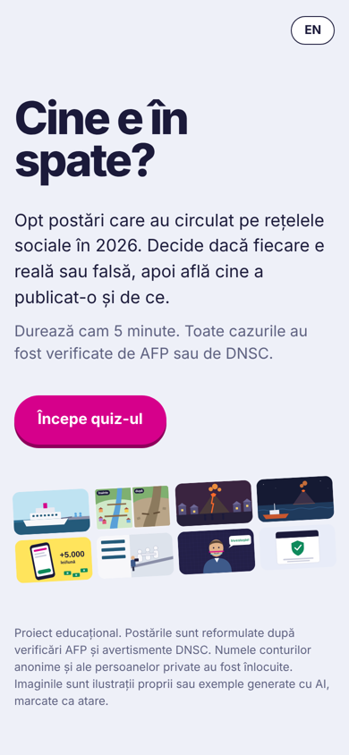
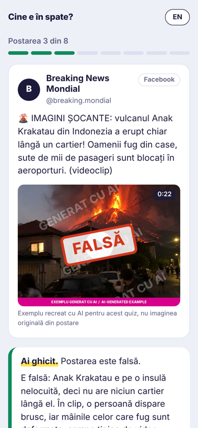
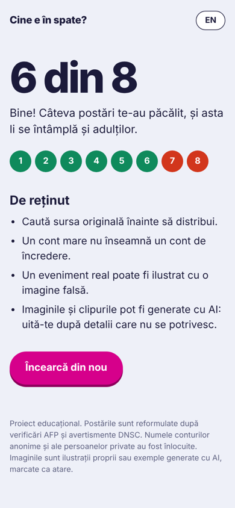

# Who's Behind It? / Cine e în spate?

A short, bilingual (Romanian / English) quiz that teaches teenagers to tell real news posts from fake ones on social media, and to ask the question that matters most: **who is behind this account, and why are they posting it?**

**Try it:** https://thomas-gilca.github.io/who-is-behind-it/

  
  
  

## How it works

1. You see a post as it circulated on Facebook, Instagram or YouTube.
2. You decide: real or fake?
3. The app shows the verdict, a short explanation with clues you could have noticed, and a **"Who's behind it?"** file: what kind of account published it, who controls it, and a link to the full fact-check.

The 8 posts are real cases from 2026, rewritten in my own words:

| # | Case | Verdict | Technique |
|---|---|---|---|
| 1 | Hantavirus evacuation from the MV Hondius cruise ship | Real | – |
| 2 | "Before and after" collage of the Nepal floods | Fake | AI-generated images of a real disaster |
| 3 | Volcano erupting next to a neighbourhood | Fake | AI-generated video, label removed when reposted |
| 4 | Eruption filmed from a fishing boat | Real | – |
| 5 | "Earn thousands of lei from home" ad | Fake | Hijacked page, look-alike news site |
| 6 | "Staged" evacuation photo with a cameraman | Fake | Old photo taken out of context |
| 7 | Public figure "recommending" an investment | Fake | Deepfake scam |
| 8 | Official warning about deepfake scams | Real | – |

**Sources:** [AFP Verificat](https://verificat.afp.com) (AFP's Romanian fact-checking service) and warnings from [DNSC](https://www.dnsc.ro), Romania's National Cyber Security Directorate. Each post links to its fact-check.

## Responsible use of AI

AI tools were part of this project, and every AI output was checked before it was published. The full process is documented in [JURNAL-VERIFICARE.md](JURNAL-VERIFICARE.md) (in Romanian).

- **Explanations:** first drafts by Gemini Flash. All 8 were checked against the original fact-checks and corrected. In one case the AI invented a plausible but false justification (post 6).
- **Images:** posts 2, 3, 5 and 6 use example images I generated with ChatGPT, because the original images are copyrighted and republishing them would spread the fake content again. Every one is marked **"GENERAT CU AI / AI-GENERATED EXAMPLE"** inside the image itself. The other posts use hand-made illustrations.
- **Code and review:** I built the app with help from Claude (Anthropic), which I also used to compare the AI explanations with the sources.

## Privacy and fairness

- Names of anonymous pages and private persons are replaced with generic names.
- No case takes a side in Romanian party politics, so the quiz can be used in any classroom.
- The app collects no data: no accounts, no tracking, nothing is saved.

## Technical details

Plain HTML, CSS and JavaScript, no frameworks, hosted on GitHub Pages.

| File | What it does |
|---|---|
| `index.html` | Page structure |
| `style.css` | Design: colours, layout, the verdict stamp |
| `data.js` | The 8 posts, explanations and sources |
| `media.js` | Hand-drawn SVG illustrations |
| `app.js` | Quiz logic: screens, answers, score, language switch |
| `images/` | AI-generated example images (watermarked) |

---

## Pe scurt, în română

Un quiz în care adolescenții decid dacă o postare de pe rețelele sociale e reală sau falsă, apoi află **cine se află în spatele contului** și de ce publică. Cele 8 cazuri sunt reale, din 2026, verificate de AFP și DNSC. Explicațiile scrise cu AI au fost verificate și corectate, iar procesul e descris în [JURNAL-VERIFICARE.md](JURNAL-VERIFICARE.md).

Made by **Thomas Gilca**, first-year Computer Science student, Faculty of Mathematics and Computer Science, University of Bucharest, 2026.
